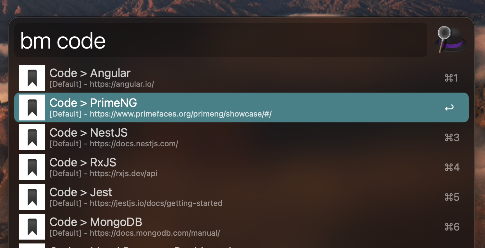
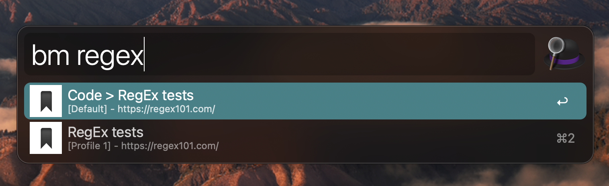
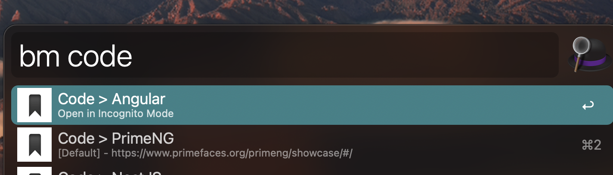
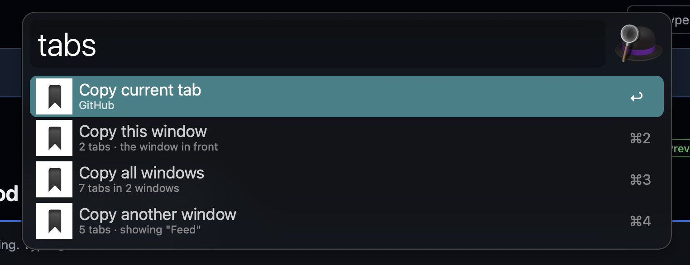

# Alfred Search Bookmark

## Description

Search your bookmarks across Chrome profiles with 'bm', and copy your open tabs as Markdown links with 'tabs'.

## Search bookmarks

1. Type 'bm' in Alfred, then part of a bookmark's name
2. Press Enter to open it in its Chrome profile, or Command + Enter to open it in incognito

## Copy open tabs

1. Type 'tabs' in Alfred
2. Press Enter on a row to copy the selected tabs, the current tab, a window or all windows as Markdown links
3. Or type a word to find a tab: Enter copies it, Command + Enter switches to it

To copy only some tabs, Command or Shift-click them in Chrome first. That row needs Alfred under Accessibility in System Settings.

## Examples

### Search bookmarks with keyword `bm`:

 

### Search bookmarks across multiple profiles:

 

### Enter a bookmark via incognito mode:

 

### Copy open tabs with keyword `tabs`:

