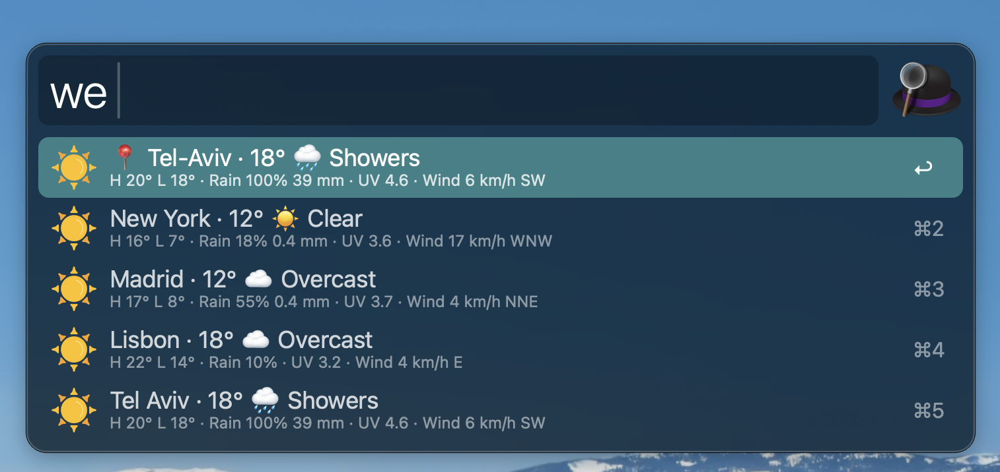
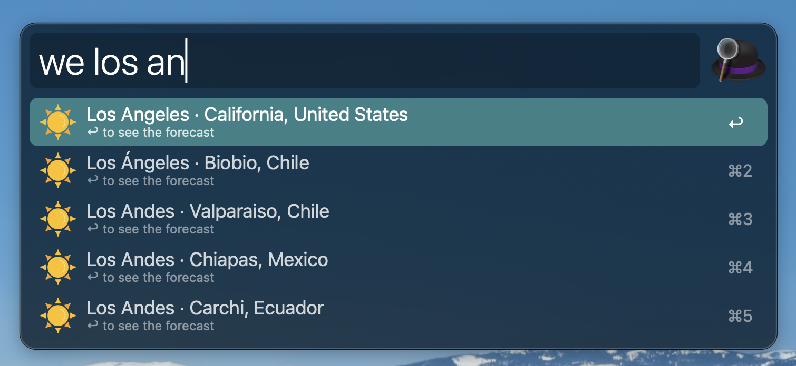
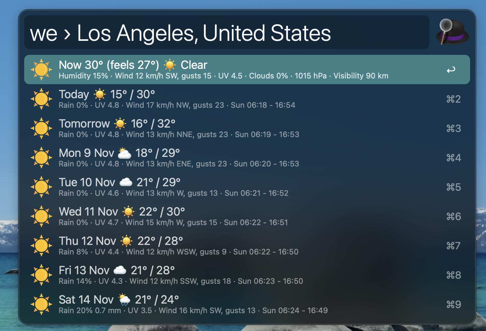
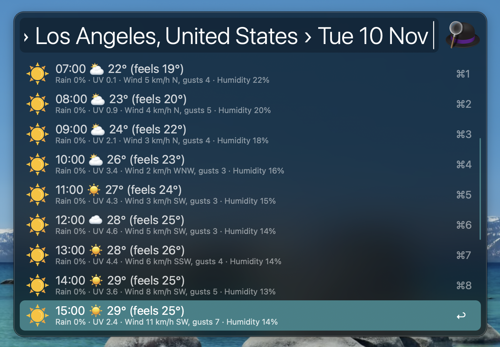

# Alfred Weather

## Description

The weather forecast for your saved places and your current location, up to 16 days ahead, with [Alfred](https://www.alfredapp.com/). No API key needed.

## Features 🥷

- Shows the weather where you are and at your saved places
- Today's high and low, rain, UV index and wind at a glance
- A forecast of up to 16 days for each place, with every field of a day in Large Type
- An hour-by-hour view of any day

## Usage

1. Open Alfred and type `weather`
1. Type part of a place name to filter the list, or any city to find it
1. Press ↩ on a place to see its days, and `⌘L` on a day to see every field
1. Press ↩ on a day to see it hour by hour

## Settings

| Setting          | Default   | What it does                                                  |
| ---------------- | --------- | ------------------------------------------------------------- |
| Keyword          | `weather` | Opens the forecast                                            |
| Saved places     | empty     | One per line: a place name like `Haifa`, or `Label: lat, lon` |
| Current location | on        | Shows the weather where you are, found from your IP address   |

## Demo

### Your places

### Find any city

### The days of a place

### A day hour by hour

Weather data by [Open-Meteo](https://open-meteo.com) (CC BY 4.0). The current location comes from your IP address.
