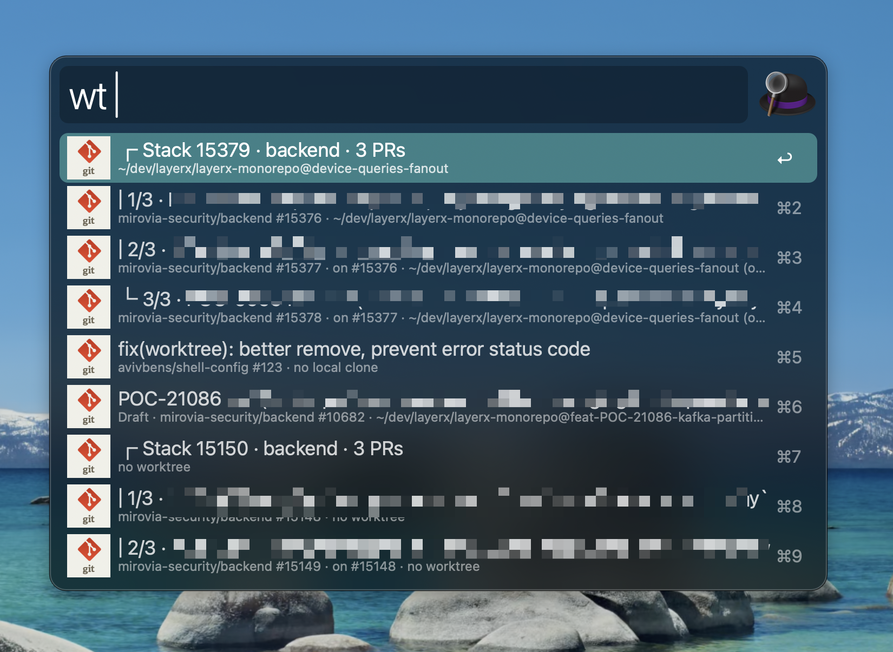

# Alfred Worktree Launcher

## Description

Open or create git worktrees for your pull requests and new tasks, then start an agent session in them, with [Alfred](https://www.alfredapp.com/).

## Features 🥷

- Lists your open pull requests, review requests and pull requests assigned to you, and shows which ones already have a worktree
- Creates the worktree next to your local clone as `<repo>@<name>` and installs dependencies
- Groups the pull requests of a GitHub stack and opens them in one folder
- Starts a new task in its own worktree, on a fresh branch off the default branch
- Opens the worktree in VS Code or Cursor, or starts an agent session in it

## Requirements

The [GitHub CLI](https://cli.github.com) (`gh`), logged in with `gh auth login`.

## Usage

1. Open Alfred and type `wt` followed by a space
1. Type part of a title, repo, number or branch, or paste a pull request URL
1. Choose a pull request and use one of the keys below

| Key | Action                                                        |
| --- | ------------------------------------------------------------- |
| ↩   | Open the worktree in your editor, creating it first if needed |
| ⌘ ↩ | Start a new agent session in the worktree                     |
| ⌥ ↩ | Resume the last agent session in the worktree                 |
| ⇧ ↩ | Open the pull request in the browser                          |

## Stacked pull requests

The pull requests of one GitHub stack show together under a `Stack` header. ↩ on any layer opens the stack's folder, `<repo>@stack-<n>`, on that layer.

## New task

1. Open Alfred and type `wtn` followed by a task name, for example `wtn Agenda view`
1. Press ↩, then pick a repo
1. Press ↩ to open the new worktree in your editor, or ⌘ ↩ to start an agent session in it

The branch is `feat/<name>`, off the latest default branch. Start the name with `fix/` or `migration/` to use that prefix instead.

## Settings

| Setting               | Default         | What it does                                                         |
| --------------------- | --------------- | -------------------------------------------------------------------- |
| Pull requests keyword | `wt`            | Lists your pull requests, review requests and assigned pull requests |
| New task keyword      | `wtn`           | Starts a new task in its own worktree                                |
| Repo folders          | `~/dev`         | Folders scanned for git clones                                       |
| Scan depth            | `3`             | How many folders deep to look for clones                             |
| Editor                | VS Code         | VS Code or Cursor                                                    |
| Terminal App          | Native Terminal | Native Terminal, Warp or iTerm2                                      |
| Agent command         | `claude`        | Command that starts an agent session                                 |
| Agent resume args     | `--continue`    | Added to the command to resume the last session                      |
| Install dependencies  | on              | Runs the package manager install after creating a worktree           |
| Number of results     | `20`            | How many rows to show                                                |

## Demo

